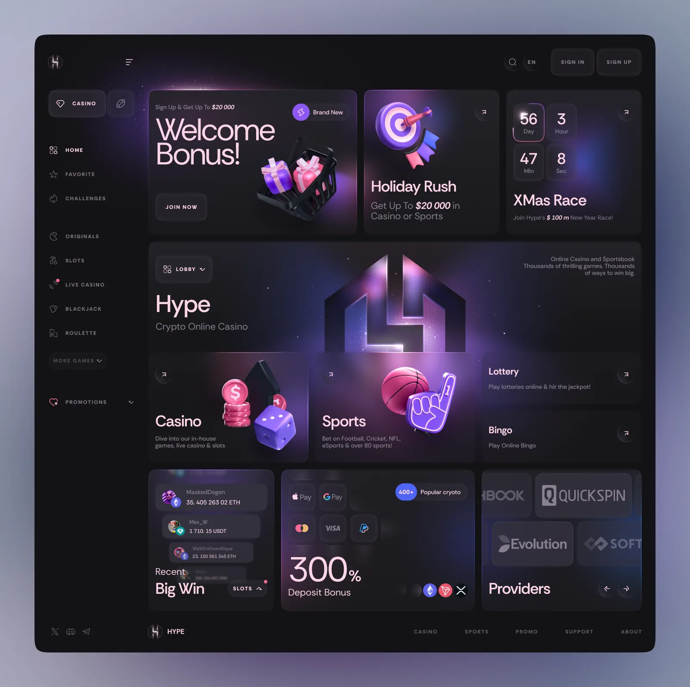
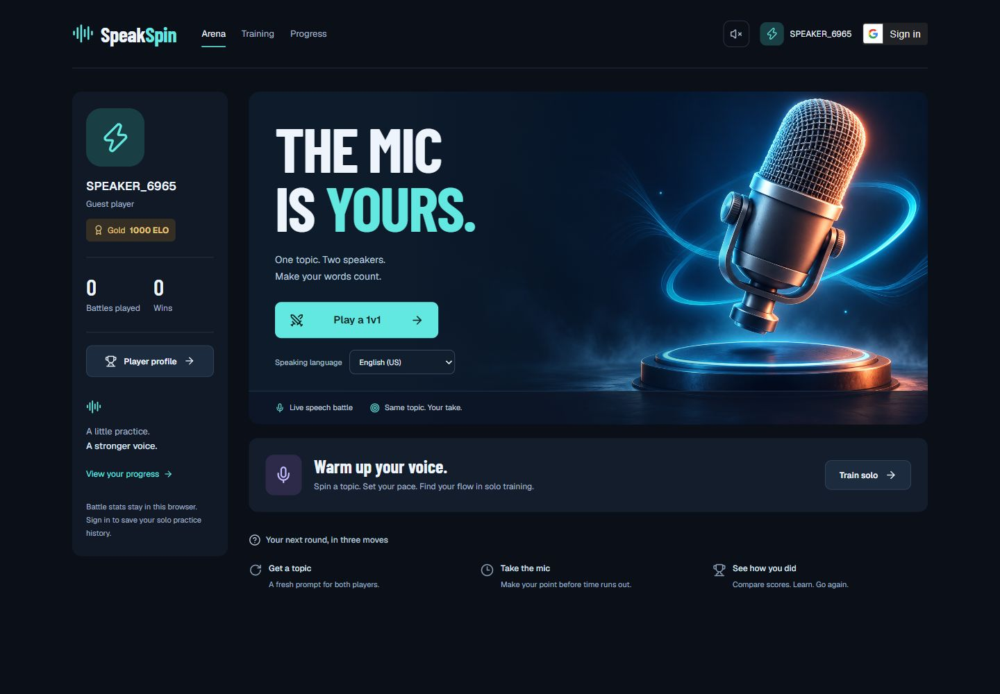
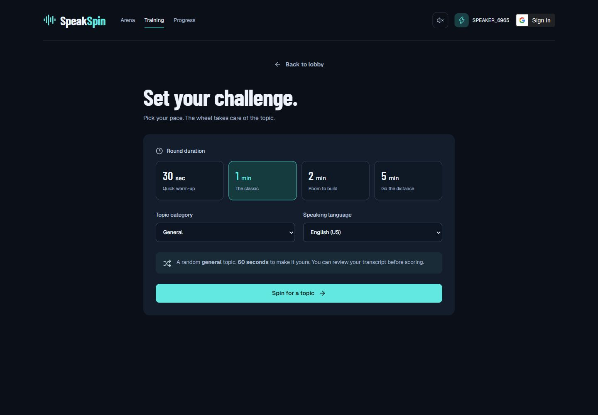
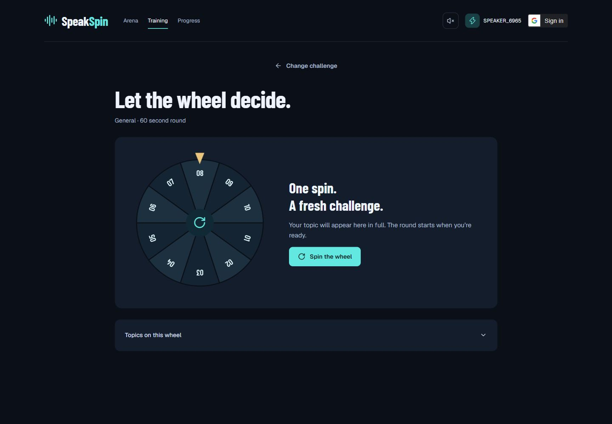

# SpeakSpin: dimensional game hub redesign

Status: initial redesign plan, 9 November 2026. Implementation is recorded in IMPLEMENTATION.md. The user's subsequent refinement replaces the five-card lobby proposal: keep only Multiplayer and Solo cards, remove the rank/profile card and both lower record cards, and access the profile through the player icon. This refinement takes priority over the original composition below.

## The direction

SpeakSpin should feel like opening a speaking game: choose a mode, see your player identity, and enter a round. The current version puts a game illustration inside a conventional app layout. This redesign changes the layout, artwork, materials, controls, and round presentation together.

The visual target is [Game Dashboard Interface by uixNinja](https://dribbble.com/shots/25615857-Game-Dashboard-Interface). This newer reference replaces the previous cyan arena direction as the target for the next iteration. PRODUCT.md remains the authority for existing functionality; DESIGN.md describes the incumbent design until the new direction is implemented.

## What the reference gets right

The reference uses charcoal surfaces, violet light, pink highlights, dimensional illustrations, soft bevels, and an asymmetric tile grid. Artwork overlaps tile boundaries. Several related objects establish one visual world. Navigation is quiet, leaving illustrated destinations prominent. Broad, mixed-case headings soften the otherwise dark composition.

This image is review evidence with attribution. Build original speaking-related artwork for the product. Its casino content, promotional claims, and payment modules do not belong in SpeakSpin. The lavender surround is presentation framing, rather than a required app background. The static shot supplies no evidence about mobile behavior or interaction.

## What is wrong with the current version

| Current decision | Why it misses this direction | Replacement |
| --- | --- | --- |
| Large profile/stat sidebar beside a promotional hero | Player administration occupies a major part of the first screen | Quiet navigation rail, compact player identity, playable mode tiles |
| One polished microphone image surrounded by flat panels | The artwork and interface feel like separate layers | A coordinated family of 3D objects, materials, lighting, and controls |
| Giant condensed slogan above small supporting text | Reads like a product landing page | Mode names and playable actions carry the hierarchy |
| Strong navy/cyan palette throughout | Produces a different mood from the supplied reference | Neutral charcoal, violet light, blush text accents, restrained warm highlights |
| Thin borders and uniform rounded rectangles | Most screens share the same application-panel silhouette | Varied tile sizes, edge highlights, inset surfaces, raised controls, overlapping objects |
| Solo mode reduced to a horizontal secondary strip | Solo looks like a utility attached to the main product | A substantial illustrated destination beside Battle |
| Centered duration/category form | Starting a round feels like configuring software | A compact round-selection scene with tactile duration controls |
| Flat numbered topic wheel | The signature game object has little material presence | A dimensional wheel, physical-looking pointer, illuminated hub, clear selected topic |
| Similar panel treatment through setup, play, and feedback | The game lacks distinct moments | Separate lobby, preparation, versus, live-round, and result compositions |

### Current lobby: composition needs replacement

Captured from the running app at 1440 × 1000. Both modes work as entry points, but the profile rail, slogan, and single hero dominate the screen.

### Current solo setup: reads as a settings form

The current controls are understandable. Keep those choices while changing their composition and material treatment.

### Current wheel: needs to become the central game object

The selection mechanism should remain legible. Its presentation should feel substantial enough to anchor the game.

These three screens were inspected live. The remaining screen recommendations below are based on the source and existing flow; they are proposals, not claims of completed browser verification. This review did not exercise recording, sign-in, scoring, or a live match.

The preview also emitted a React warning about the LandingScreen image's `fetchPriority` prop. Resolve that compatibility warning when replacing the lobby image implementation.

## 1. Replace the lobby composition first

Use a narrow desktop navigation rail with Lobby, Solo, and Player record. Keep account and sound controls compact. Remove the separate full-height profile/stat column and the redundant promotional explainer row.

Use an asymmetric main grid with approximately 16–20 px gaps:

| Region | Proposed content | Visual treatment |
| --- | --- | --- |
| Large upper tile, roughly half the content width | **1v1 Battle**; short round description; **Find match** | Two sculpted microphones facing each other, violet/pink edge lighting, one dominant raised button |
| Medium upper tile | **Solo practice**; **Choose a round** | Dimensional topic wheel with its pointer crossing the tile edge |
| Compact upper tile | Current rank and actual ELO | Original rank crest, large readable rating, compact record link |
| Wide lower scene | Last completed round, when available | Result-led presentation using the real topic and score; direct Play again action |
| Smaller lower region | Recent practice or battle record | Real saved entries; an intentional first-round invitation when empty |

Do not fill empty space with fabricated events or statistics. A new guest can have a shorter lobby. Mode artwork should remain visible even when there is no history. Keep the main action inside its mode tile and give each tile a distinct purpose.

The resulting thumbnail should be visibly different from the current hero-and-sidebar layout before any text is read.

## 2. Establish one visual and asset system

| Element | Proposed treatment |
| --- | --- |
| Base | Near-black charcoal, starting around #101014, with smoked surfaces around #1C1B23 |
| Light | Violet pools of light and pink rim highlights, concentrated around artwork and selected controls |
| Type | Off-white primary text, blush accent headings; broad contemporary mixed-case display type; readable body text |
| Tiles | Soft edge lighting, subtle inner highlights, layered depth, varied footprints; decoration kept behind content |
| Buttons | Raised face and visible lower edge; clear pressed state; strongest fill reserved for the current primary action |
| Icons | One consistent utility icon family; original illustrated crests for player identity and rank |
| Motion | Brief tile lift, wheel spin, versus entrance, and score settlement; quiet scenery during speaking |

Create the asset family before building every screen:

1. A microphone-duel composition for Battle.
2. A dimensional topic wheel for Solo, with a functional wheel built in the UI.
3. A small original set of player crests mapped to existing avatar choices.
4. Rank crests mapped to the existing rating tiers.
5. A restrained arena backdrop and result lighting variants using the same materials.

Use consistent camera angle, scale, surface finish, and violet/pink light across assets. Deliver transparent cutouts where objects overlap tiles, with smaller mobile variants. Keep all labels, scores, controls, and wheel logic in the interface rather than baking them into images. The existing microphone poster cannot be the sole source of visual character.

## 3. Carry the style through the complete game loop

| Screen | Planned change | Existing implementation area |
| --- | --- | --- |
| Lobby | Illustrated mode selection, compact identity, real rank/record | LandingScreen, App shell |
| Battle preparation | Player crest and microphone scene; compact language and identity controls beside entry action | BattleLobby, AvatarSelector |
| Solo preparation | Round-selection scene with raised duration chips, category and language controls | TimerSelector |
| Topic wheel | Larger dimensional wheel with pointer and hub; selected topic displayed in full outside the wheel | SpinWheel |
| Matchmaking | Two player positions in an arena; waiting position and clear Cancel action | Matchmaking |
| Opponent found | Versus composition with player crests, names, rank, and microphone readiness | OpponentFound |
| Topic reveal | Full topic takes priority; clear preparation countdown | TopicReveal |
| Speaking | Topic, remaining time, recording status, and finish action dominate a quieter arena | SpeechRecorder, BattleRecorder |
| Analysis | Honest processing state with a restrained arena transition and recovery if it fails | AnalyzingScreen, BattleAnalyzing |
| Results | Outcome, player/opponent score, actual rating change, and Play again first; coaching details below | BattleResults, FeedbackDashboard |
| Player record | Player identity, actual rank/record, and saved sessions; detail pages may use compact rows | BattleProfile, ProgressHistory |
| Sign-in and errors | The same materials and typography, with direct recovery actions | LoginScreen, SignupPrompt, shared notices |

The shared system in App.css and GameUI should unify these scenes without putting every scene inside the same centered panel. Gameplay can use the viewport more fully than a history or account screen.

## 4. Preserve the game behavior

- Keep guest entry, Google sign-in, duration choices, categories, languages, transcription, scoring, feedback, and rematches.
- Keep automatic bot pairing after five seconds without a bot-choice prompt or separate announcement. Preserve cancellation, disconnect, human-match, and retry timer cleanup.
- Keep microphone readiness before a round starts, readable topics, and recoverable permission/network failures.
- Keep actual ELO, rank, and saved history. Battle statistics currently use browser storage; do not imply they are account-synced.
- Keep the existing player identity and storage mappings when replacing avatar illustrations.
- Keep sound preferences and reduced motion. Do not use continuous movement behind the speaking task.

XP, currencies, daily quests, unlockable rewards, and global leaderboards would require separate product behavior and persistence. They are not needed to achieve this visual direction and should not appear as decorative controls or invented values.

## 5. Design the phone layout deliberately

At desktop widths, use the illustrated grid and quiet rail. At tablet widths, reduce the grid to two columns. At 360–430 px, stack Battle and Solo before record modules and use compact navigation. Avoid shrinking the desktop grid into tiny tiles.

Keep the Battle action visible in the first phone viewport. Scale artwork independently of text. Preserve readable player names, full selected topics, and timer controls. Use at least 44 px touch targets, visible keyboard focus, tested text contrast, and reduced-motion alternatives. Decorative glows must not obscure text or signal the only distinction between states.

## Implementation order and review gates

### A. Prove the new lobby visually

Produce a high-fidelity desktop lobby and a corresponding phone composition with representative original artwork. Compare them directly with this reference and the current screenshot. Settle the layout, materials, type proportions, and art direction here before applying them across the codebase.

**Gate:** the lobby reads as the same visual family as the supplied reference through composition, depth, and artwork, while clearly belonging to a speaking game. Both modes remain immediately understandable.

### B. Build the foundation and lobby

Create the coordinated assets, surface/button/type tokens, navigation shell, player crests, and mode tiles. Implement the replacement lobby. Update DESIGN.md to describe the implemented system and remove conflicting incumbent prescriptions.

**Gate:** desktop and phone screenshots match the agreed composition, including empty guest and returning-player states. Every visible control has working behavior.

### C. Redesign the connected round scenes

Apply the system through solo preparation, wheel, versus, topic reveal, recording, analysis, and results. Finish player record, sign-in, loading, and error states after the playable loop is coherent.

**Gate:** a player can move from Lobby to Play again without falling back into the current flat form/panel design. Topic and timer legibility take priority during play.

### D. Verify presentation and behavior

- Capture representative scenes at 1440 px, 768 px, and 390 px; check overflow at 360 px.
- Check long player names, long topics, empty history, sign-in failure, microphone denial, analysis failure, and disconnect recovery.
- Check keyboard focus, reduced motion, touch targets, and 200% zoom on core controls.
- Check the browser console through the core flow and resolve the existing image-prop warning.
- Run the production build and existing relevant tests. Exercise human matching, the five-second fallback, cancellation, and microphone lifecycle when their required services are available.
- Report which live integrations were actually exercised; a build alone does not verify them.

**Final acceptance:** dimensional art and materials are present across the game; Battle and Solo have substantial visual destinations; result scenes lead with the outcome; phone controls remain usable; existing behavior is preserved; every displayed number comes from real state.

## Immediate next deliverable

A replacement lobby mockup for desktop and phone, using the new charcoal/violet/pink material system and original Battle/Solo artwork. This is the first implementation milestone, before another whole-app styling pass.
